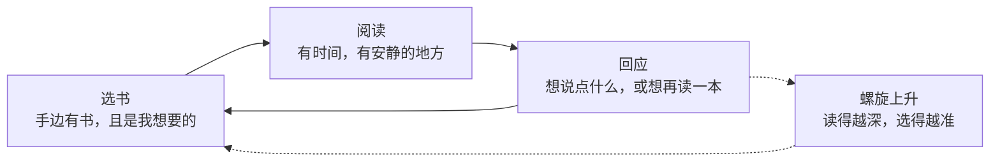
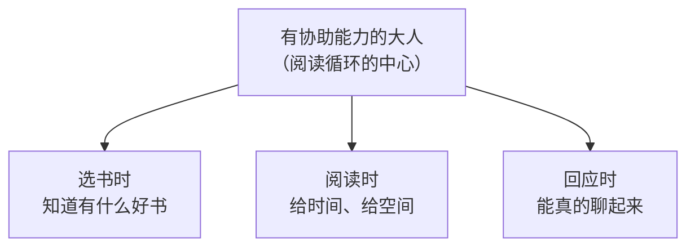
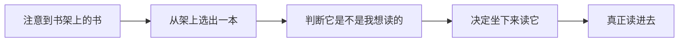

# 拆书 · 打造儿童阅读环境

> The Reading Environment · 艾登·钱伯斯（Aidan Chambers）· 许慧贞 译 · 原版 © 1991

**一句话读完这本书**

孩子爱上阅读，不靠天赋，靠**环境**。而这个环境的中心，是一个**自己也在读书的大人**。

## 这本书在讲什么

艾登·钱伯斯是英国儿童文学作家，也是阅读推广人。这本书不是讲"怎么教孩子识字"，而是讲一个更前置的问题：

**一个人是怎么变成读者的？**

他的答案很简单，也很硬：**读者是由读者造就的。** 一个从不阅读的大人，没办法帮孩子成为读者——不是方法问题，是他根本不知道那扇门后面是什么。

所以这本书写的其实是两件事：给孩子搭什么样的环境，以及大人自己要先成为什么样的人。

## 核心框架：阅读循环

全书的骨架是一张图，钱伯斯叫它"阅读循环"：

三个环节首尾相接，转一圈就是一次完整的阅读经历。转得好，会变成螺旋——**读得越深，下一次选书越准**。

而这张图的**正中心**，站着一个人：

钱伯斯强调：中心点不是"老师"或"家长"这个身份，而是"**有协助能力**"这个状态。双向箭头也提醒——大人同样可以从孩子身上学到东西。

## 环节一：选书

> 鼓励阅读的首要任务，就是学习如何选择并建立一批丰富的藏书。

这里有三个条件，缺一不可：

**1. 书要够多，且包含孩子感兴趣的种类**

书少，遇到可读之书的概率就低。但钱伯斯补了一句关键的：**如果数量多而类别单一，还不如数量少但都是孩子感兴趣的**。

**2. 书要随手可得**

书里讲了他 9 岁时的经历：教室里大概有 50 本故事书，全锁在柜子里，只在周五下午开放几分钟挑一本回家过周末。

> 这看起来似乎只是一件微不足道的小事，但事实上，类似的状况也发生在许多学校里。

他还点名了两种常见做法：

- 学校有漂亮的图书馆，但老师怕弄脏书，不鼓励孩子用——**图书馆变成了展示场所**
- 班里有书，但只有表现好的孩子才能读——**阅读变成了奖励**

后一种尤其糟：对没被奖励的孩子，阅读成了一次**失败经验的标记**。

**3. 陈列方式决定孩子会不会拿起来**

书脊朝外还是封面朝外、放在什么高度、有没有推荐语——这些细节决定了"看见"和"拿起"之间的距离。

## 环节二：阅读

钱伯斯特意给"阅读"加了引号，因为他要拆掉一个误解：

> 阅读可不仅仅是将眼睛扫过文字而已……将书里的文字装进脑袋只不过是其中的一个小环节。

对刚学阅读的孩子，**每一个步骤都算数**：

大人能做的，是**在孩子每完成一步时给出肯定**，而不是只庆祝最后一步。

另外两个硬条件：

- **时间**——读文学作品需要专注，不是碎片时间能对付的
- **空间**——一个不被打扰的地方。电视机开着，就很难静下来

## 环节三：回应

读完一本书，人会有反应。钱伯斯说，有两种回应最珍贵：

**第一种：想再来一次。** 重读这本书，或找同一作者、同一主题的其他作品——**这就回到了"选书"，循环闭合**。

**第二种：想和人说。** 迫不及待想告诉别人自己读到了什么。

> 谈论书籍大概有两种形式，一种是非正式的，属于朋友之间漫无目的的闲谈；另一种则是在教室或研讨会中的正式讨论。

关键在于：**讨论会把循环扩展成螺旋。**

- 听朋友说"这本好看"→ 你会去找那本 → 新的选书
- 为了说清楚自己的感受 → 你会重新整理这本书 → 读得更深

所以"回应"不是阅读的终点，是下一轮的起点。

**但有个陷阱**：孩子只是想享受睡前故事，不想每次都被问"说说看最近读了什么书呀"。

> 我所期望的是，阅读能使孩子们学会思考。

区别在于——**和孩子讨论书籍的是什么样的人**。会聊的人能把孩子带进深处，不会聊的人只会把阅读变成作业。

## 大人：三种角色

译者序里，王志庚把"有协助能力的大人"拆成了三类人，说得很实在：

| 角色 | 位置 | 关键动作 |
|---|---|---|
| **妈妈** | 家庭 | 自己爱读书；家里有孩子专属书架；每天固定共读时间 |
| **老师** | 课堂 | 不只是语文老师的事；带读、提问、组织读书会 |
| **图书馆员** | 家庭与课堂之外 | 连接每一个儿童和图书 |

对图书馆员，他给了三个动作，我觉得对孩子身边所有大人都适用：

- **蹲下来**——放低身心，从孩子的视角看，才知道他真正需要什么
- **多读书**——自己先是个读者，才推荐得出对的书
- **讲故事**——用孩子听得懂的语言讲，而不是照本宣科

## 环境里还有哪些零件

除了这三个环节，书里还拆解了很多具体装置：

- **班级藏书**：书从哪来、谁买、经费怎么解决
- **图书馆**：地点选择、第一眼印象、维护、展示方式、装置与设备
- **阅读时间**：多久让孩子自己选一次书、能花多少时间读自己喜欢的书
- **讲故事**：从自己开始讲、建立自己的故事库、慎重选书、准备、发现文字的戏剧效果
- **活动**：图书俱乐部、学校书店、图书展览会、邀请作家来访
- **回应活动**："你读过这本书吗"、图书涂鸦板、杂志、读者剧場、制作图书
- **读者社群**：保留阅读时间、相互协助、自我充实

这些不是清单，是**同一张图上的零件**——每一个都在为"让循环转起来"服务。

## 几个反直觉的地方

**1. 阅读不只是"读懂字"**

学龄前的孩子拿着《小玻在哪里》翻书，学怎么把书拿稳、怎么对付翻不好的薄书页——钱伯斯说，那一刻的成就感，**不输给一个评论家终于读懂《尤利西斯》**。

**2. 奖励会毁掉阅读**

把读书当奖励，等于告诉孩子：读书是苦差的报酬，不是享受本身。

**3. 大人的"身教"没法替代**

> 一个从不阅读，或者缺乏阅读经验的大人，是难以为孩子提供协助的。

这句话没有商量余地。你可以买一屋子书、报最贵的阅读课，但如果你自己不读，孩子学到的就是"读书是要求我做的事"。

## 能马上做的五件事

- [ ] 在家里/教室里，让书**露出来**（封面朝外，放在孩子够得着的高度）
- [ ] 每天留一段**固定的、不被打扰的**阅读时间——大人也一起读
- [ ] 孩子读完一本，**别急着提问**，先聊你自己读到了什么
- [ ] 让孩子参与**选书**，哪怕选了你觉得"没营养"的
- [ ] 大人自己，每周读完一本孩子看的书

## 关键句

> 读者也是由读者造就的。

> 阅读的世界不应该是平面的二维空间，而是立体的三维空间。

> 如果我们的小读者，能够有一位值得信任的大人为他提供各种协助，分享他的阅读经验，那么他将可以轻易地排除各种横亘眼前的阅读障碍。

## 怎么读这本书

- **家长**：第 1 章（阅读循环）→ 藏书与陈列 → 阅读时间
- **老师**：阅读循环 → 讲故事 → 回应活动
- **图书馆员**：全书，尤其藏书、陈列、活动三章

原书全文见 [book.md](book.md)，75 张插图在 [images/](images/)。
