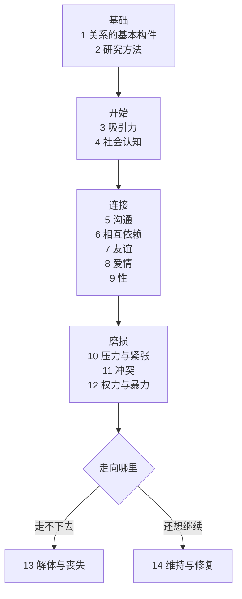
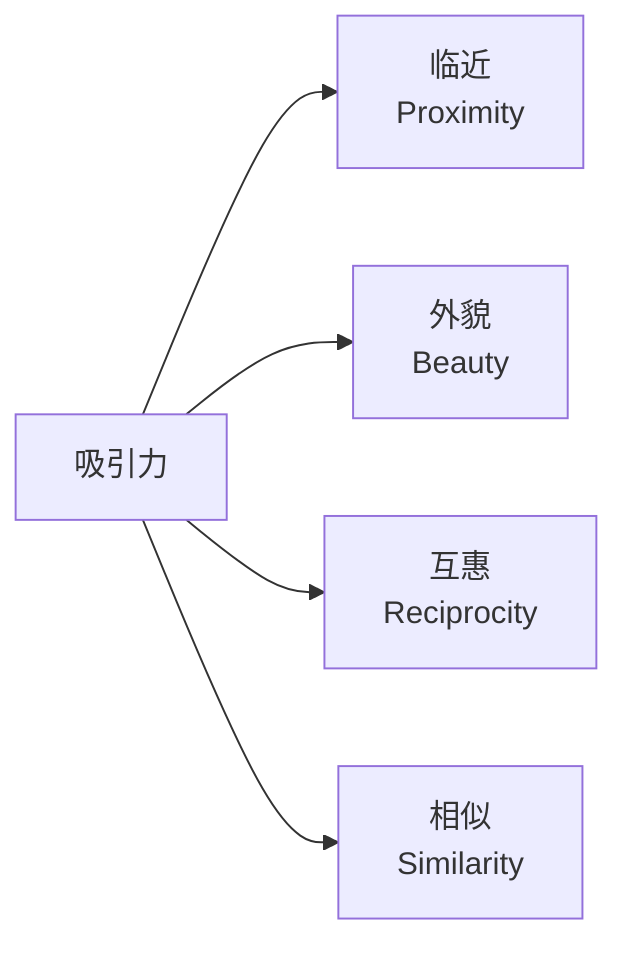

# 拆书 · 亲密关系（第 9 版）

> Intimate Relationships, 9th Edition · Rowland S. Miller · 教材

**一句话读完这本书**

亲密关系不是玄学，是一门**有实验数据的学科**。这本书把"两个人怎么走到一起、又怎么走散"拆成了 14 个可研究的环节。

## 这本书是什么

它不是情感鸡汤，是**大学教材**。每一章都有文献综述、数据表格、量表和参考文献——第 1 章后面就跟着 60 多页的 REFERENCES。

作者 Rowland Miller 是关系科学领域的教科书作者，全书建立在**实证研究**上，而不是个人经验。

书的结构非常清晰：**14 章，正好对应一段关系的完整生命周期**。

## 全书地图

前两章是**方法论地基**，中间九章是**关系怎么建立和加深**，后四章是**关系怎么坏掉、以及能不能修**。

## 起点：归属需要

书里第 1 章先给了一个底层假设：**人有一种"归属需要"（need to belong）**——和吃饭睡觉一样，是基本需求，不是软弱。

围绕这个需求，有四层影响：

| 层次 | 影响什么 |
|---|---|
| **文化** | 什么时候结婚、和谁结婚、离婚是否可接受 |
| **经验** | 童年经历塑造**依恋类型** |
| **个体差异** | 性别、人格、自尊、性取向 |
| **互动** | 两个人具体怎么相处 |

**依恋类型**是全书反复使用的工具（第 1 章表 1.1）：

| | 低回避 | 高回避 |
|---|---|---|
| **低焦虑** | 安全型 | 疏离型 |
| **高焦虑** | 痴迷型 | 恐惧型 |

这个二维模型在后面的沟通、冲突、修复章节里反复出现——**同一个行为，四种人会有四种解释**。

## 吸引力：四个变量

第 3 章把"为什么喜欢一个人"拆成了四个可测量的因素：

- **临近**：住得近、见得多。重复接触会增加好感（熟悉效应）
- **外貌**：存在"美即是好"的刻板印象；匹配假说——人们倾向于和外表相当的人在一起
- **互惠**：我们喜欢喜欢我们的人
- **相似**：态度、价值观、背景的相似度，比"互补"更能预测关系稳定

书里还专门讨论了**"互补"到底成不成立**——结论是：**感知到的相似**比客观相似更重要。

## 中间段：认知 → 沟通 → 互赖

第 4 到第 6 章，是从"感觉"到"结构"的三级跳：

**第 4 章 社会认知**——我们怎么理解伴侣。理想化、归因偏差、记忆重构、自我实现预言。核心一句：**你以为什么样，关系就可能变成什么样**。

**第 5 章 沟通**——非言语（表情、眼神、身体、触碰、距离、气味、语调）+ 言语（自我表露）。以及沟通坏掉时的修法：直接表达、积极倾听、尊重与确认。

**第 6 章 相互依赖**——这本书最"经济学"的一章。用两个指标判断一段关系：

| 指标 | 含义 |
|---|---|
| **CL**（比较水平） | 我认为我"应该"得到什么 |
| **CLalt**（替代比较水平） | 我离开这段关系，能得到什么 |

两个指标交叉出四种关系类型，也解释了那个反直觉的现象：**一段糟糕的关系之所以维持，往往不是因为爱，而是因为 CLalt 太低**（没得选）。

## 后半段：磨损与结局

**第 10 章 压力与紧张**、**第 11 章 冲突**、**第 12 章 权力与暴力**——三章讲关系怎么被消耗。

第 12 章有个重要区分：**权力**（谁影响谁）和**暴力**（谁伤害谁）不是一回事，但前者失衡常常是后者的土壤。

最后两条路：

- **第 13 章 解体与丧失**：分手的过程、谁提的分手、分手后的叙事重构
- **第 14 章 维持与修复**：什么行为能维持关系（积极错觉、共同活动、承诺）、修复的可行手段

## 最值得记住的三个结论

**1. 承诺不是感觉，是结构**

第 6 章讲得很清楚：承诺来自**满意度高 + 替代选择差 + 投入大**。三者缺一，承诺就脆弱。

**2. 归因方式比事件本身更致命**

同一件事（对方迟到），安全型的人想"他堵车了"，痴迷型的人想"他不在乎我"。第 4 章和第 11 章都在讲这个。

**3. 修复比预防难得多**

书里没有给"如何不吵架"的答案，而是给"吵架之后怎么修"——因为冲突不可避免。

## 怎么用这本书

- **想理解自己**：第 1 章（依恋类型）+ 第 4 章（认知偏差）
- **正在关系里卡住**：第 5 章（沟通）+ 第 11 章（冲突）
- **在犹豫要不要继续**：第 6 章（CL / CLalt）+ 第 13 章（解体）
- **想系统学**：按顺序读，它是教材，章节之间有依赖

## 一点提醒

这是**美国样本为主的教材**，很多结论基于大学生和已婚夫妇的问卷。文化差异（尤其集体主义社会里的家庭介入）在书里是单独一节，但权重不高。读的时候留个心眼：**统计规律不等于你这段关系的命运**。

---

原书全文见 [book.md](book.md)，115 张图表在 [images/](images/)。
